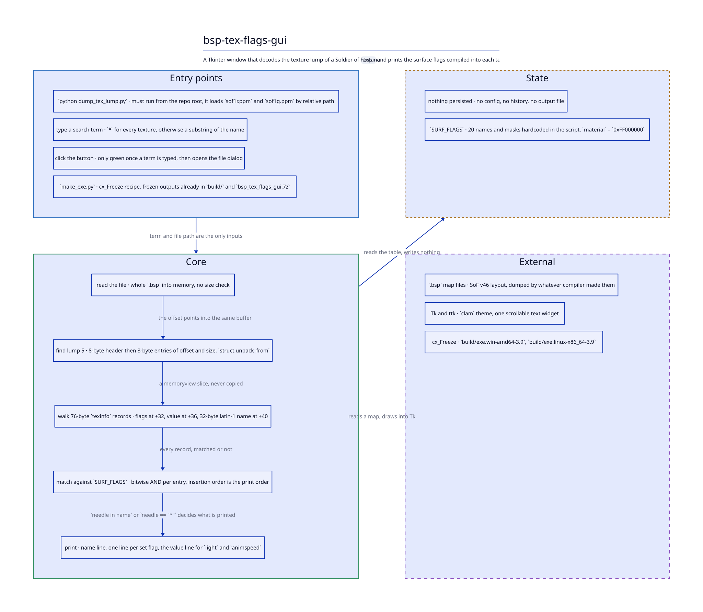

# bsp-tex-flags-gui

A one-file Tkinter window that opens a Soldier of Fortune `.bsp`, decodes its texture lump, and prints the surface flags compiled into every texture whose name matches your search term.

Read it left to right:

- **The whole tool is one 76-byte record and one dictionary.** Tkinter is only the shell: the map is read into memory, lump 5 is located through the `offset,size` entry at byte 8 + 5×8, and each `texinfo` entry is unpacked at fixed offsets — flags at +32, value at +36, a 32-byte latin-1 name at +40. No BSP library, no validation of the header.
- **`value` only means something for two flags.** `light` and `animspeed` borrow the same mask bits as ordinary flags but carry a number instead; the printer knows this and emits a `value ==` line for exactly those two, and for nothing else.
- **The material mask hides gravel.** `material` is `0xFF000000`, so any textured surface reports it alongside the specific `type_metal` / `type_stone` / `type_wood` bit. `type_gravel` is `0x00000000`, and `flags & 0` is always false — so gravel, the material value 0, is the one type the tool can never show you.
- **Nothing is saved and nothing is checked.** There is no config, history or export; the search term lives in a `StringVar` and the list is re-walked from the beginning for every click. The two PPM images in the repository root are loaded by relative path, so the script only runs from the repo root.
- **The repository ships binaries, not just source.** `make_exe.py` is a cx_Freeze recipe and `build/` already holds frozen win-amd64 and linux-x86_64 (Python 3.9) trees, so the `.7z` is a release artifact of this same script rather than a vendored upstream.

Diagram source: [`docs/system.d2`](docs/system.d2) · renderer: [`scripts/render-diagram.sh`](scripts/render-diagram.sh).
